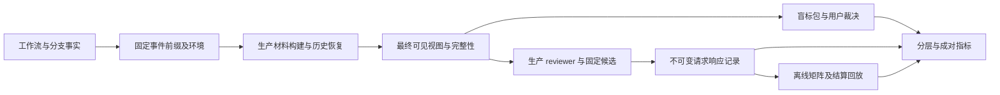

# 复杂工作流评测与审查质量校准

状态：2026-11-01 issue 图发布依据。用户已授权使用 Relay milestone-to-issue-graph auto mode 创建新 milestone、协调 parent 并细化执行 issues；编号在发布后记录于 GitHub parent。远端核实 milestone #2、#83、#84 已关闭，#85 开放且无 milestone/parent，保留既有 #84 依赖并由新阶段接管。本文定义新阶段范围，不授权立即执行真实模型调用或宣布质量通过。

2026-11-01 执行口径更新：数据制作由 agent 独立完成并自动校验，后续标注发现材料问题回交修订。参考标注首版由 Codex 导出统一 prompt、答案格式和隔离题本，用户转交其他模型独立作答并回传，Codex 校验导入、保留原意见、计算共识；每个审查点的作答上下文隔离作者答案、未来事件和其他意见。用户转交不构成人工确认，亲自标注、复核与裁决使用 #128 本地网页。自动标注 API 不是首版必交能力；S2 有界自动运行保留，适用资源按运行计划执行。本段优先于下文与此冲突的旧派发表述。指标与版本比较复用 evals/src/metrics/ 计算核心，report 负责渲染输出，issue #129/#133 已补齐写入归属。

发布边界：上一轮人工全审/抽检比例及模型参考正式用途仍是待确认建议，由首批试标后的复核与资源计划任务形成明确决定，在受影响的正式使用前确认；目标模型、额度与最终验收数值分别在首批运行前和终评前确定。工程与数据契约不依赖这些未定数值才能开始实施。所有执行 issue 必须保留这些未来决定的权限边界，不能把图发布解释为自动确认。

目标是回答三个问题：复杂工作流中的材料是否被正确送审，reviewer 是否准确识别后果与有效授权，以及同一公共矩阵在这些评分上是否符合用户裁决。首先设计可解释的工作流，再补足输入和测量能力，最后扩充数据和运行校准。2026-10-31 用户确认数据目标约 300 个根工作流、约 1,500 个基础审查点，按完整 lineage 以 5:3:2 分组，先做 24 根约 120 点试标。目标不是统计充分性或通过条件；旧 600 点总目标改作中期检查规模。细分覆盖配额和标注流程仍需试标/讨论，真实模型运行额度另行确定。

配套草案：

- [代表性工作流与审查点](complex-workflow-evals-workflows.md)：12 类业务蓝图、18 个问题索引和 5 种连续轨迹，包含事件顺序、可见材料、正反变体及人类回复后继续执行。
- [数据集、标注与评测方案](complex-workflow-evals-data.md)：已确认 24 根/120 点试标、约 300 根/1,500 点扩充及 5:3:2 分组；集合文件、旧集迁移、模型意见与参考、标注分层、指标、CLI 完整报告和版本归档、实验及冻结流程。
- [任务拆分与交接](complex-workflow-evals-tasks.md)：8 个合并后的工作包、必要依赖及验收条件，包含工具结果持久化及新增的完整报告 CLI/版本归档任务。
- [Prompt 结构与参数说明](complex-workflow-evals-prompt.md)：逐项说明新方案的来源、顺序、保位、预算和配置，附当前生产实现差异。

## 1. 与当前 milestone 的边界

用户已决定把复杂场景评测与最终质量验收移到新 milestone。当前阶段保留无探针 A、现行矩阵和 N0，修复归一化边界及报告问题，完成生产接线、规则体验、旧测试数据清理和隔离宿主验收。工程基线可用不等于模型质量通过。

本草案的代码观察基线是本地 `66be571`。2026-10-31 读取远端时，[#83](https://github.com/Yuee98/dsh-arbiter/issues/83) 的正文已经调整为本阶段基线与工程验收范围；[#85](https://github.com/Yuee98/dsh-arbiter/issues/85) 仍为 open。这些状态不是新阶段的最终接管证明，发布任务图前需要回读其 milestone、父子关系和阻塞边。

| 工作 | 当前 #2 | 新阶段 |
| --- | --- | --- |
| `1e-4` 容差的浮点边界、S1 报告勘误 | dsh 修复并验证 | 接收修复后的基线，不重复实施 |
| 无探针 A、现有量表、矩阵、N0 | 确认工程基线 | 默认沿用；实验变更单独版本化 |
| 生产和 evals 一致性、宿主接线、旧数据重置 | dsh 收尾 | 复用证据，新增变化补针对性验收 |
| 完整上下文评测输入、事件与历史恢复回放 | 移交 | 本阶段工程范围 |
| 复杂工作流、新数据、标注、S2 | 移交 | 本阶段数据及实验范围 |
| 最终候选、质量数字、独立保留集 | 移交 | 本阶段冻结与验收，承接 #85 |

现在可以完成场景、数据契约和任务草案。实现冻结需要接收 #83/#84 的实际 Git commit 与配置，不要求等待 #2 形式关闭。大批量标注在有效送审材料格式冻结后开始；真实调用还需要本阶段的目标和资源计划，旧阶段额度不自动扩大到新范围。

2026-10-31 用户明确要求评测保持轻量：以 Git commit 作为代码、数据、标签、prompt 和配置的共同版本依据，不另建各层 hash 链、内容 manifest 或审计版本体系。运行时参数、模型信息和实际响应复用现有运行记录；案例关联使用稳定 ID。具体边界见 §3.3，适用于配套数据、prompt、任务与报告方案中所有版本和追溯要求。

整体实现也按这个原则收敛：8 个工作包、三类核心数据集合、一套生产/评测共用输入、一套指标与报告。逐事实追踪、通用场景/继承引擎、全量消融及高级统计按实际问题再考虑。首批可用后立即进入分批制作和 S2，不等待所有诊断能力齐备；必要的来源、可见性、失败分母和参考独立性检查继续保留。

旧阶段未执行的 C1–C4 全套消融、N0 变体和 cold/warm 缓存比较保留为可选研究，不自动成为新 milestone 的验收条件。首版先跑默认 A，再根据明确问题加少量对照；重复用于评估必要的稳定性，矩阵实验复用已有分数离线执行。探针 B 已被否决，不重开。

本次只新增规划文档，不修改 dsh 正在维护的旧方案、决定记录、运行记录、源码或 GitHub 关系。

## 2. 现有能力及具体缺口

### 2.1 数据与输入

当前旧工件名为 `core-v1`，新布局统一改称 `legacy-v1`，并保留旧名到新名的迁移映射；历史工件中的 ID 不回写。该集有 51 条、16 个家族，dev/calibration/holdout 分别为 13/22/16；来源是 1 条真实、6 条重构、44 条合成。对 51 份 case 的结构统计显示：工具 context 非空为 0，hint 非空为 1，custom rules 非空为 1，子会话案例为 3；42 条只有 1–2 项 evidence。这批数据继续作为简单锚点和历史回归证据，不充当新增复杂工作流的独立样本。

| 能力 | 现状与证据 | 新阶段需要补足的部分 |
| --- | --- | --- |
| 来源与许可 | [case 类型](../../evals/src/data/types.ts) 仅有 `kind/ref/note`；[适配器](../../evals/src/run/material.ts) 从 note 推断来源 | 显式事件来源、session/parent 归属、时序和 ask 绑定，禁止依赖自然语言注释猜来源 |
| 当前 turn 工具历史 | case 只表达 tool/arguments；适配器合成时间顺序，没有工具结果状态 | 按 §2.6 建立本会话统一时间线，保留来源、事件序号、call/result 关联、结果状态及待审调用排除；新方案不设固定最近 N 轮门槛 |
| 工具结果持久化 | Arbiter SQLite 保存执行状态与时间，历史工具快照只有结果状态；DSH 会话事件另有结果内容 | 独立保存可取得的工具结果和来源，覆盖前置查询调用；审查快照保持执行前的实际视图 |
| checkpoint 与先前裁决 | 适配器固定 `checkpoints: []`、`priorVerdicts: []`、`turn: null` | 表达 checkpoint、真实阶段链、同调用多来源合并及冲突；经生产选择与裁剪后送审 |
| 来源可读性 | `caseCompleteness` 将会话/父会话设为可读，无父会话读取要求 | 可读空、缺失、失败后补读成功、最终不可读、压缩丢原文等状态，复用 M0 分类 |
| 输入预算 | 已复用 `truncateSnapshot`，但前面的材料不足，提取阶段仍有字符截断 | 取消 prompt 前置字符截断，集中实现可配置常态目标/硬上限、保位和动态裁剪；同一内容在不同预算下单独绑定有效视图 |
| 先前裁决恢复 | 生产已有 [DecisionHistory](../../src/host/history.ts) 和 session/audit 来源 | 临时 SQLite 与事件源驱动生产恢复，区分完整、部分、未知、窗口裁剪、重置 |
| 标注材料 | 当前导出原始 `ReviewInput`，不是最终送审视图 | 标注者与模型读相同有效事实；预算与投影变化可使旧标签失效 |
| 金标资格 | [eligibility](../../evals/src/data/eligibility.ts) 通过当前矩阵检查 behaviour，并将无分数标签排除 | 分开评分、行为、M0 的可评资格；实验矩阵不能使原本不利于它的行为参考被剔除 |
| 配对和统计 | 已有分 target、repeat 与 family 数；单调性比较同条件内金标有序的案例 | 补必要的对照关系、工作流统计和条件分母；高级聚类区间按分析需要再做 |
| 离线回放 | 已支持响应读取、N0 `strict/at-least` 和结算 | 增加明确版本的公共矩阵实验；不得把它与现有 N0 阈值轴混称 |
| 报告与版本归档 | 已有 `pnpm evals report`、JSON/Markdown/静态 HTML、三层指标与逐例表 | 复用现有 CLI，补复杂工作流分类、参考来源、版本对比、运行后完整报告和按版本提交的 Markdown 工件包 |
| 预算与费用 | 单 run attempt 上限可用；跨 run 累计和金额证据不完整 | 汇总已有 run 记录并检查剩余额度，不建独立账务系统；报告实测/估算/未知 |

### 2.2 生产能看见什么

[材料渲染器](../../src/reviewer/material.ts) 已定义 policy、环境、授权、当前 turn 工具历史、先前裁决、待审动作、派生事实、hint 和完整性报告。新数据应覆盖这些材料之间的关系，不要求每条案例填满所有字段。

当前实现与评测必须遵守的事实边界：

1. 当前生产工具历史仅保留参数和 `result.ok`，不包含完整 stdout/文件内容。这是实现现状，不是新阶段不可改变的产品约束。源轨迹可以有工具输出，但某个候选未将其投影到 prompt 时，不能用这些隐藏事实要求该候选判对。已确认的新输入范围见下节。
2. 工具成功表示宿主记录了成功，不证明文件内容已脱敏、备份可恢复或业务目标达成。重要后果事实需要在实际可见材料中有依据。
3. 原始工具历史只取当前 turn；有效人类许可与限制可以跨 turn。父会话原文与子会话继承 seed、兄弟会话历史应分别处理。
4. checkpoint、工具内容、assistant 和 hint 不产生人类许可。原始 ask 问题与人类回答应一起保留，未回答不成为同意。
5. 常规截断、来源已知为空和历史不完整不自动成为 M0 阻断；只有共享契约识别的阻断缺口才走相应路径。不要借新数据引入语义弃权 M1。
6. 当前 A1 的有效禁止、R/A 独立性、无独立风险上限及 ask/no-ask 语义保持。本文不预设模型应为每一类命令给固定分数。

### 2.3 工具输出：已确认的首版范围与实现细节

用户提出：删除目录前的 `ls` 结果等环境检查，可能比单独的工具参数及成功状态更有助于判断。2026-10-31 用户确认首版处理文本和可序列化结构化结果，经共同脱敏、来源标记与统一预算后送审；图片、音频及附件只保留实际可得的类型、引用和未提供正文说明，多模态判断留待后续。工具结果进入新方案已是确定方向，不再以“是否加入输出”作为待决产品问题；仍不要求 dsh 在当前 #2 改动生产输入。

2026-10-31 用户已确认：SQLite 补充工具结果，作为新 milestone 的必需能力，由 CW-18 交付。记录按 session/call 关联，覆盖插件采集范围内可观测的前置查询等未触发模型审查的工具调用；保存实际取得的正文、状态、时间和截断来源。工具执行后新增结果记录，不回填执行前的审查快照。日志采集上限与 prompt 上限分开。用户进一步确认大结果可以转文件，SQLite 保存关联元数据、引用与哈希，retention 沿用日志统一规则；文件占用纳入统一容量计算，随引用及过期记录统一回收，不另建独立保留期限。采集上限与转文件阈值已确认，见 §2.5。此决定不是立即修改或重置当前数据库的指令。

工具结果的已确认原则与待定细节如下；预算和截断的首批试标基线见 §2.4，最终生产默认值仍依据校准结果冻结：

| 项目 | 已确认原则或起点 | 实现及校准事项 |
| --- | --- | --- |
| 采集与送审选择 | 采集已启用范围内可观测的调用；按 §2.6 的机械选择与时间线组织送审，不设固定最近 N 轮门槛 | 特定工具排除规则及可达性；读取/缓存保护另行校准，不默认扫描无关会话或日常历史 |
| 结果格式 | 首版处理文本与可序列化结构化结果；图片、音频及附件仅保留可得类型、引用和未提供正文说明 | 核实宿主载荷形态、通道与缺失状态；不新增附件下载、OCR、转写或二进制展开，多模态判断后续另做 |
| 长度与保留 | 已确认 §2.4/§2.6 的可配置常态目标/硬上限、取消前置字符截断、机械保位与动态配额，以及 §2.5 的独立日志限制 | 6,000/10,000 token 为初始默认候选，最终默认值按首批试标校准；日志数字按实际长度分布和截断率校准 |
| 裁剪与摘要 | 已确认原文片段、按块/行保留头尾各半、标出省略，首版不默认追加模型摘要 | 各工具结构化提取作为独立对照；不得拼成貌似完整的截断 JSON |
| 敏感内容与可复现性 | 已确认：落盘与送审前共用凭据脱敏，保留字段类别、对象关系及处理版本 | 实现时明确识别规则与反例；不能把已有 reviewer 凭据遮蔽误当成完整工具输出脱敏 |

来源始终保持为工具观测；普通输出中的许可声明不升级为用户授权，ask 的实际人类回复继续走宿主问答绑定路径。失败、无结果、空正文、不支持内容、上游截断与本地截断分别记录。去重、晚到结果、重启恢复、落盘失败和清理后的缺失属于必需工程验收，不另设逐项产品审批。

2026-10-31 用户已确认以下脱敏方案。现有 `maskAttempt` 主要在 transport 完成后遮蔽已知 reviewer 凭据与认证字段，它不是工具结果的统一采集/送审前脱敏器。新增窄范围、可追溯的材料处理：已知凭据及明确的密码、认证 token、Cookie、私钥等敏感值使用有类型、可区分的占位符；普通路径、接收方、文件类型、数量、失败原因及有效授权语义尽量保持。不能以长字符串、含 `key` 或高熵为由一概删除普通内容，也不声称自动识别了全部自由文本隐私。

已确认的数据路径为“宿主提供的结果 → 共同脱敏材料 → 日志正文（SQLite 或文件）/按预算生成 prompt”。脱敏在本插件持久化和外发之前进行，日志保存较充分的处理后材料，审查快照保存当次送审视图；首版不默认额外落盘一份未脱敏原文或可逆的秘密映射。同一工作流内，相关参数、结果、问答引用与错误材料中的同一值保持一致标识，不同值不能都塌缩为同一个占位符。仅处理送审和审计副本，不改实际工具执行参数或宿主返回，也不改变 DSH 自身的日志政策。

运行保存处理后的实际材料和必要的来源/裁剪说明，不记录被遮蔽原值；处理规则从对应代码与配置追溯。若归档时再次遮蔽，说明与实际外发材料的差异。基于处理后源材料可重放预算，但无法恢复已去掉的原值。共享数据的额外去标识按选定工件执行并复核标签，不先建设通用导出规则平台。

同一个待删目录审查点可以比较以下材料方案，具体候选在实验计划中冻结：

| 材料方案 | 实际提供的信息 | 要回答的问题 |
| --- | --- | --- |
| 当前基线 | 工具参数与成功/失败/无结果 | 缺少内容时的判断与人工负担是什么 |
| 有界相关原始输出 | 与当前对象有关的目录列表、类型或状态查询结果，保留来源及截断标记 | 增加可核查事实能否改善后果判断，预算和干扰增加多少 |
| 可追溯的结构化事实 | 从原始结果提取的对象、路径、类型等字段，关联原始记录与提取器版本 | 能否节约预算，是否漏掉决定性内容或引入提取错误 |

例如，`ls` 可提供观测到的目录项；它本身不证明完整递归范围、数据可再生成或仍是执行前的最新状态。必须保留命令、cwd、call/result 对应、观测时间、退出状态与省略情况，必要时用额外查询补足事实。工具文本作为环境证据，不升级为用户许可；输出里的“用户已批准”仍按其实际来源处理。

先用 W01/W09/W15/W16/W17 设计删除对象识别、状态变化、前置条件、输出注入和预算竞争的配对点。比较同一根情境、同一待审动作、同一授权；只改变可用材料及预先声明的投影方案。原始轨迹不把输出内容改写成用户陈述来模拟“已支持输出”。材料变更后标签绑定各自有效视图，可记录信息充分性变化，不能强行复用基线金标。

事件 schema 保留首版范围内带来源的工具结果载荷；现有生产仍按旧契约运行，新材料由可被生产复用的构建路径生成，两协议和盲标包共用，不在 eval prompt 中私加生产拿不到的内容。需补齐宿主采集、截断、来源与验证，再冻结受影响数据视图和生产候选；原状态-only 方案保留为对照。首版支持未完成时如实记录工程缺口，不能把只保存日志或手写理想视图当成已完成结果送审能力。

连续任务还需要区分两个问题：工具结果正文是否可见，以及人类回复开启新 turn 后，先前工具事件是否继续可见。当前原始工具窗口只取当前 turn；前台 ask 回复、迟到答复和普通对话回复是否跨 turn，要按实际宿主事件判断，不能统一当作同轮。新方案按已确认的 §2.6 组织与裁剪，不设固定最近 N 轮门槛，跨 turn 本身不再把较早工具事件排除出候选。保留观测时间、来源及实际可见事件，由 reviewer 判断对象事实是否仍适用；构建器不推断相关性、授权有效性或自然语言指代，也不永久追加全部历史。当前轮或有限轮数窗口仅保留为旧基线/评测对照，分别记录实际信息丢失，不能给基线 reviewer 一个生产拿不到的累计全文。

### 2.4 已确认的统一输入预算与截断基线

详细字段、选材顺序、配置迁移和边界示例统一维护在 [Prompt 说明](complex-workflow-evals-prompt.md)，本文只保留摘要，避免多份规则漂移。

- 常态目标 T 和硬上限 H 均可配置，初始 6,000/10,000 个估算 token；普通工具调用整体、assistant、checkpoint、hint 的单条额度为 `min(常态剩余额度, floor(T × 10%))`，没有独立工具池。
- 取消提取阶段 prompt 字符截断、20／5／40 条数限制和固定最近 N 轮门槛；旧配置迁移不把这些值改名为读取保护。
- 基础输入不超过 T 时补普通历史；处于 T 与 H 之间时只送基础输入；超过 H 时先裁规则、最后裁当前动作，保护原文仍保留，无法满足则准备失败，降级后不回填普通历史。
- 来源读取、缓存、日志容量与 prompt 预算分开。先复用既有读取和缓存，按实际接口保证有界和如实记录缺失；性能瓶颈出现后才增加必要优化。
- 完整输入含协议包装、来源和省略标记，两协议共用选材并复核长度。普通省略不自动产生拒绝或人工询问，已丢失的源内容不能靠提高预算恢复。

### 2.5 已确认的日志采集上限与转文件阈值

2026-10-31 用户确认：单次工具调用最多保留 1 MiB 结果正文，超过 64 KiB 转文件。这两个数字作为新 milestone 的初始默认值，根据实际长度分布和截断率校准；不改变 §2.4 的 prompt 预算。

| 脱敏后的正文大小 | 保存方式 |
| --- | --- |
| ≤ 64 KiB（65,536 字节） | 正文直接存 SQLite |
| ＞ 64 KiB，且 ≤ 1 MiB（1,048,576 字节） | 正文存文件，SQLite 保存引用、大小及哈希 |
| ＞ 1 MiB | 保留头尾各约 512 KiB，正文存文件，明确记录中间省略 |

大小按共同脱敏后、序列化且未压缩的正文 UTF-8 字节数计算。一次工具调用的 stdout、stderr 和多个内容块合计共享 1 MiB，保留各自通道与来源，不给每个块单独分配 1 MiB。转文件只改变存储位置，不删除内容；超过采集上限才进行本地日志裁剪。

超限时尽量对齐完整行或内容块，并保持有效 UTF-8；对齐不能使保留正文超过总上限，超长单行也须有界处理。记录可知的裁剪前长度、实际保留区间、截断原因和处理版本。哈希标识实际保存的正文，不把片段哈希当作完整源结果的哈希；日志中未保留的中间部分不能通过增加 prompt 预算恢复。上游已截断、日志采集截断和 prompt 裁剪分别记录，截断 JSON 不冒充完整对象。

处理采用有界方式，避免为了截断而额外无界复制全文；分块处理仍须满足落盘及送审前的共同脱敏规则。日志正文与 prompt 使用可追溯的共同材料，采集限制不反向改写实际工具结果，也不改变已经保存的执行前审查快照。

正文文件和 SQLite 继续执行统一 retention。当前配置默认 30 天、总容量 1 GiB；新实现将正文文件纳入同一容量核算，容量先达到时可提前清理，转文件不构成独立长期归档。

### 2.6 已确认的时间线组织、保位与统一裁剪

采用“父会话人类证据区＋本会话统一时间线”，两区共用预算、各按宿主原序展示。先标记本会话/直接父会话最新人类原文及明确绑定问题，再按机械规则选择普通历史；保位不改变展示位置，不做语义指代检索。详细规则见 [Prompt 说明](complex-workflow-evals-prompt.md)第 3、4、6 节。

父 agent 的 user 转述保留 relay 来源，父工具、兄弟会话及继承 seed 不自动混入。本次截止点之后的父消息或工具结果不可见，晚到结果按实际到达位置展示；父人类材料按每次截止点更新，不能为了缓存永久固定旧副本。调用与结果以 call ID 关联，当前待审动作单列。

普通 assistant 只取最新本会话人类消息之前最近一条，低优先级且不保位；没有本会话人类消息则无候选。明确绑定的问题独立保位，已有原事件 ID 去重。所选历史可以不连续，缺失/截断说明必要且真实，未知数量不编造。

### 2.7 已确认的 checkpoint 处理

保留宿主 checkpoint 读取能力，默认最多考虑最新一条，在本会话时间线原位置展示。它是低优先级摘要，不保位、不预留额度、不使用 T 到 H 的余量，按单条 C 限制，不能代替人类原文或补成人类授权。详细规则同样以 Prompt 说明为准。

小范围选择有代表性的轨迹比较“无 / 最新一条”，没有收益时可在最终配置中关闭；不要求所有案例都生成两套视图。源记录不因 prompt 省略而被改写。

## 3. 从工作流到评测记录

### 3.1 四种对象

| 对象 | 内容与身份 | 约束 |
| --- | --- | --- |
| 工作流根情境 | 初始资产、角色、任务、政策、来源、事件树；有 root/lineage/family 标识 | 作者全知设定留在作者材料，不进入模型或盲标包 |
| 审查点 | 一个分支的事件截止点、当前 session/turn、待审调用、材料配置 | 后续事件不可回流；同根分支和审查点属于同一 split |
| 有效视图 | 生产构建的 `ReviewSnapshot`、来源选择与裁剪结果、两协议实际输入 | 标签绑定实际可见事实；协议包装不同不自动意味着事实相同 |
| 观测记录 | target、候选、协议、repeat、attempt、原文/解析/usage、来源 run | 原始结果保留；模型回答不得改变另一候选将接收的上下文 |

工作流保存普通 JSON 事件列表和必要分支，沿用宿主已有消息/调用/结果形态，由薄适配器传给共享构建器。审查点指定截止点和待审动作；不另建场景 DSL、事件树解释器或通用业务模拟引擎。数据中的删除、上传或发布不会因加载评测案例而执行。

### 3.2 两条验证路径

**固定视图评测**：冻结同一审查点的有效视图，使用生产 renderer/parser/N0/matrix 比较候选。它测 reviewer 与公共策略，保证配对条件一致。

**事件到视图验证**：用受控会话事件、临时 workspace 和 SQLite 驱动 `buildSnapshot`、授权合并、工具窗口、预算裁剪及历史恢复，再与预先定义的结构断言核对。关键场景另用隔离 DSH 核验真实宿主形态。这条路径区分“输入已丢授权”和“模型误读完整授权”。

二者共享构建器与实际构建结果，测试直接比较材料和结构断言。固定轨迹的后续事件由数据作者预先冻结，不按被测模型的前次回答即时编写，因此结果不代表一个自主 agent 完成整项业务任务的成功率。完整自主演练不属于本轮必需范围。

连续轨迹是数据的主要组织方式之一：同一任务按时间推进，每个待审动作读取当时的事件前缀；后续点应包含当时已可见的 call/result、问答和有效限制，当前动作自己的结果及未来答复均不可见。互斥分支单独标识，不能把五个反事实版本伪装成五步连续执行。具体轨迹见工作流目录第 8 节。

数据以 F01–F12 业务分组，P 机制按需要打标签，W/S 仅作为选材目录，不要求每条记录填写四套分类。先写任务和连续事件，再选择审查点；root 默认就是自己的 lineage，派生变体才显式合簇。一个调用的审批阶段、诊断视图和工程 fixtures 不凑主集数量。

每个参考给出简短判断依据，必要时用原事件 ID 定位。只有复杂争议、截断损失或输入故障需要额外作者说明与逐步诊断，不要求所有根维护状态/证据账本。作者目标不进入 reviewer 或盲标输入；模型评分按实际可见材料判断，公共矩阵仍使用独立期望行为评价。

主集使用固定轨迹逐点评测，包括原轨迹已发生的审查记录，本次模型答案不回填后续点。另以少量参数化集成/E2E 用例验证真实宿主批准、拒绝、无回复、迟到回复和恢复等续行路径；只执行隔离工具，实际获准才产生结果。工程用例可用确定性 reviewer 替身，不要求每个工作流根都执行真实业务或真实模型序列。

### 3.3 Git 追溯、运行记录与标签适用性

代码、数据、标签、prompt 和默认配置放在同一仓库，通常一个被测 `gitCommit` 即可定位；名称、版本更新和审阅依据由 Git diff/历史承担。本文其他位置的“版本”“冻结”默认指对应提交与实际采用的配置，不要求给量表、投影、渲染、参考或共识规则分别维护版本号、hash 或 manifest。确有格式兼容需要时保留一个 `schemaVersion`，它只决定如何读取数据。

- 保留稳定的 root/lineage/point/view/call 等 ID，用于关联、分组和定位；事件截止点、各 session 的顺序、来源可读性、选取和裁剪直接记录，不转换成额外的内容身份链。
- 每次运行复用现有运行目录与 plan/结果记录，保存 run ID、被测 commit、时间、实际配置、target/可知模型版本及参数、响应、失败和用量。同一提交能定位的源文件不再逐项附带校验值，报告也不复制一套审计清单。
- 本地试跑允许未提交修改，明确标记工作区有改动；没有保存这些改动时，不宣称单靠 commit 能复现。正式可追溯报告采用已提交的被测输入，但不自动替用户提交。后来提交报告的 commit 不冒充被测 commit。
- Git 无法代替仓库外的模型响应和运行参数，这些继续保存在原运行工件中；附件以路径/链接引用。只有文件完整性校验或已有缓存去重等具体实现确实需要时才保留内部 hash，不要求用户维护，也不逐层展示。
- 标注批次记录所用 commit、配置及实际材料，意见和参考用稳定 point/view ID 关联；输入变化时用 Git diff 和实际视图比较复核适用性。合并文件、格式化或无关代码修改不会自动使标签失效；删历史、换预算或改变证据归属也不能仅凭 ID 相同继续复用。
- 原始轨迹和参考的修订由 Git 保存历史，运行保留当时采用的参考及结果；按新参考重算时明确说明。旧格式已有字段和运行证据按原义读取，不为落实简化而重写历史，也不要求先重构现有运行器。

## 4. 必需能力及可观察验收

| ID | 能力 | 必须观察到的结果 |
| --- | --- | --- |
| C01 | 显式场景及来源契约 | 来源不可用由读取状态表达；冲突的关联、未来引用、重复事件及跨 session 错绑被拒绝或明确报告 |
| C02 | 生产投影与事件前缀 | 同一前缀稳定生成同一可见材料；选取与排序分离，迟到答复/结果只影响其到达后的审查点且不被挪回较早位置 |
| C03 | 连续工具与人类交互 | 成功、失败、无结果保持三态；问答绑定原问题；待审动作及未来结果不进入历史；审批后续行、拒绝和中止路径符合宿主契约 |
| C04 | 父子与历史恢复 | 父人类证据区与本会话时间线各自有序；角色为 user 的 relay 不升级，兄弟历史不混入；恢复冲突和不可读不伪装成空 |
| C05 | 预算与材料完整性 | 可配置常态目标与硬上限集中裁剪，无 prompt 前置字符/条数/固定轮数门槛；源长度与最终长度分开，必要省略信息真实，材料损失按代表案例诊断 |
| C06 | 可见材料盲标 | 标注者可复查实际视图；设计目标、参考分数、被测模型成绩和隐藏后续事件不泄漏 |
| C07 | 分层参考与指标 | 人工/继承、模型暂定参考与未解决状态分别记录；approved 无分数参考仍可进入适用的 M0/行为指标，技术失败和未派发分别公开；已确认的共识规则见数据方案 §4.3 |
| C08 | 配对、轨迹与家族统计 | 显式关系验证控制变量；root/point/view/attempt 和工程 fixtures 分开计数；逐点和整条固定轨迹表现分别统计，缺失节点不冒充全通过，相关案例不冒充独立样本 |
| C09 | 公共矩阵实验 | 默认矩阵逐格等同生产；替代矩阵复用同一个判定入口，标签不随候选变动 |
| C10 | 运行记录与预算 | 区分候选、独立重复、repair、派发前阻断与 unsupported；汇总 run 记录核对支出 |
| C11 | 完整报告 CLI 与版本归档 | 同一报告对象输出 JSON/Markdown/HTML，覆盖全部计划状态及分类/逐点结果；默认配置可追踪，每版 Markdown 工件包与实际被测 SHA/源结果对应，离线重建不发请求 |

C01–C11 是行为验收索引，不各建一个模块、平台或 issue。生产输入与评测共用实现，工程用例进入现有测试，核心指标复用现有报告；高级诊断按需要增加。完整报告在最终交付前完成，首批 S2 不被扩展 HTML 或全部指标阻塞。用户已确认由 CW-04 增加本地单人标注页，复用现有导入/校验/标签文件；不扩展为托管多人平台，见数据方案 §4.1。通用自主用户模拟平台和生产矩阵编辑面板仍不属于首版。

模型意见继续保留，包含可取得的原始可见响应、结构化答案、简短理由与证据。数据方案 §4.3 已按用户确认不固定模型数量 N；一致票数 K 至少三，且“占比至少 80% 或至少 N−1 票”。本轮确认剩余意见每维最多一档、独立期望行为全体一致、跨 A1 或关键证据冲突转人工、缺答不缩 N 且补齐前不自动采用。新增意见可更新或撤销模型参考，旧记录可追溯。人工复核范围和机器参考正式验收用途仍待确认，建议见数据方案 §4.1：首批全审，其余约 20% 根随机抽检并补齐关键/争议必审；关键门槛依人工参考，普通模型参考经检查后可参与正式综合指标。已确认的本地网页降低阅读与填写成本，本身不改变参考资格。

## 5. 需要解决的策略评测耦合

当前 `unreachedBehaviour()` 用生产矩阵判断行为标签能否由允许分数到达。这对既定契约的一致性校验有价值，但如果拿实验矩阵重复做此校验，会使与该矩阵冲突的参考失去资格。

以下职责需要区分，但不要求四套手工标注或四套存储：

1. **评分参考**：用户依据量表裁决的 R/A 与允许配对，绑定量表和有效视图。
2. **契约行为参考**：由评分参考和已知基线矩阵自动计算，用于系统回归，无需重复人工填写。
3. **用户期望行为**：用于比较产品阈值的独立裁决，记录理由；与当前矩阵不同可以构成策略发现，不能被自动删除或反向改标签。
4. **材料与工程参考**：来源选择、M0、是否应派发和结算路径由现有测试断言验证；仅特殊诊断案例需要附加预期，不给每个普通点制作工程状态卡。

这不是自动改造现有 51 条金标。旧标签保持原身份；若某条用户期望行为尚未独立裁决，则只做适用的契约回归和评分诊断，不冒充已有策略金标。

矩阵实验向共享判定函数传入少量明确的候选表/参数，默认仍是现行表；不建设策略 DSL、自动搜索或生产编辑面板。策略有效性至少约束：A1 在所有风险下 deny；固定授权时风险上升不能让要求变低；完整 A10 不被新增风险天花板阻断；同策略对两协议、所有 target 一致。候选表在看 calibration 结果前列明，具体阈值仍是产品决定。

## 6. 阶段与完成边界

| 阶段 | 交付 | 进入下一阶段的依据 |
| --- | --- | --- |
| G0 规划 | 本套草案、12 类业务蓝图、18 个问题索引、5 种轨迹与 12 类 prompt 机制、缺口与任务图 | 已确认约 300 根/1,500 点、5:3:2 及首版结果类型；继续确定标注流程及可执行细节 |
| G1 开工与接线 | 接收 #83/#84 基线；实现最小数据格式、共同输入与标注路径 | 用首批四根联调，实际问题再调整格式；不另设设计签核或重复接收报告 |
| G2 试标 | 完成 24 个开发根约 120 点，前四根包含在其中 | 主要机制有代表，核实制作/标注耗时、争议和材料损失；不另拆两次审批 |
| G3 扩充与校准 | 边制作复核、边跑 S2，扩到约 300 根/1,500 点；约 600 点做中期检查 | 使用可评批次；覆盖与来源清楚，holdout 未参与选择，不等待全部工具和诊断就绪 |
| G4 最终冻结 | 候选、用户参考、样本要求、数值线、预算、允许回归 | 在 holdout 运行前形成可执行的冻结记录 |
| G5 验收 | 按实际生产路径承接 #85 的终评，交付完整报告 | 同一报告给出工程与质量的通过/未通过/证据不足，不另建验收证据包 |

本草案不把 S1 的 `±0.5`、配对命中率 50%、不必要人工 10% 自动确认为通过线，也不把零误放称为零风险。数值与样本要求在 G4 冻结，G3 先规定指标口径和候选选择方法。工程测试随能力交付，不留到最终首次补齐。

## 7. 没有真实日志时的结论边界

完整合成轨迹可以验证具体权限机制、上下文干扰和策略边界。受控 DSH 运行可以核验事件形态与生产投影。两者仍不能证明日常请求的真实频率分布；报告按场景分层，真实来源不足时不声称线上总体误放率、重复确认率或最优成本。

实际日志导入作为后续数据来源能力：先支持使用者明确选定的工件、语义保持脱敏和來源审计，不默认扫描日常会话。真实轨迹中也可能存在错误指令、失效授权或材料缺口，不能因为来源真实就自动视为好标签。

工作流模拟方法参考 [τ-bench](https://arxiv.org/abs/2406.12045) 的用户、工具和政策交互设计；注入与正常任务并行评价参考 [AgentDojo](https://proceedings.nips.cc/paper_files/paper/2024/hash/97091a5177d8dc64b1da8bf3e1f6fb54-Abstract-Datasets_and_Benchmarks_Track.html)。本项目复用的是方法，不直接搬用其任务、分数或成功率作为验收线。
